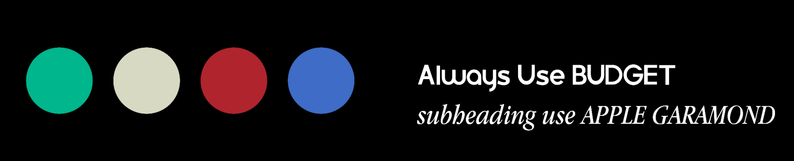

# GCC Website — Design System

Panduan bersama untuk developer website Growth Consulting (GCC).
Disusun dari aset di folder `docs` pada 28 Oktober 2026.

## 1. Sumber dan status

Referensi utama: [VISGUIDE.png](./VISGUIDE.png).



Dokumen ini membedakan dua jenis aturan:

- **Dari aset brand:** palet visual, nama font, dan artwork logo yang tersedia.
- **Usulan untuk web:** pemetaan warna ke fungsi UI, fallback font, ukuran, spacing, dan perilaku komponen. Bagian ini merupakan fondasi implementasi yang dapat disesuaikan tim, bukan ketentuan resmi yang tertulis di visual guide.

Dokumentasi ini belum berarti token atau komponen sudah diterapkan pada aplikasi.

## 2. Warna brand

Visual guide menampilkan empat swatch tanpa kode HEX atau nama warna. Nilai berikut diambil dari piksel tengah masing-masing swatch pada PNG; gunakan sebagai hasil sampling aset sampai tersedia spesifikasi warna asli.

| Nama token yang diusulkan | HEX hasil sampling | Usulan penggunaan web |
| --- | --- | --- |
| `brand-green` | `#00B68C` | Aksen identitas, highlight, ilustrasi |
| `brand-cream` | `#D8D9C2` | Background section, bidang pendukung |
| `brand-red` | `#B0242D` | Aksi utama, penekanan penting |
| `brand-blue` | `#3E6CC6` | Link, fokus, informasi pendukung |

Keempatnya adalah warna brand; pembagian primary/secondary maupun fungsi status tidak ditentukan di gambar. Jangan menganggap merah brand selalu berarti error atau hijau brand selalu berarti sukses.

### Usulan pasangan warna UI

- Tombol utama: background `brand-red`, label putih.
- Tombol sekunder: background transparan, teks dan border `brand-red` pada permukaan terang.
- Bidang hijau: teks gelap; jangan mengasumsikan teks putih terbaca pada hijau.
- Bidang cream: teks gelap.
- Link pada background putih: `brand-blue` dengan underline, terutama di paragraf.
- Netral tambahan untuk web: putih `#FFFFFF`, teks utama `#171717`, teks sekunder `#525252`, border `#D4D4D4`. Ini usulan UI, bukan warna tambahan resmi brand.

Periksa kontras pasangan aktual saat implementasi: minimal 4.5:1 untuk teks normal, 3:1 untuk teks besar dan elemen UI yang relevan. Hover, focus, dan disabled harus diperiksa terpisah.

## 3. Tipografi

Instruksi pada visual guide:

- “Always Use BUDGET”.
- “subheading use APPLE GARAMOND”. Contohnya tampil sebagai serif italic.

### Usulan penerapan web

| Peran | Font | Ukuran mobile / desktop | Line height |
| --- | --- | --- | --- |
| Judul halaman / hero | BUDGET | 36 / 56 px | 1.1 |
| Judul section | BUDGET | 28 / 40 px | 1.2 |
| Subheading editorial | Apple Garamond italic | 24 / 32 px | 1.3 |
| Body | BUDGET | 16 / 18 px | 1.6 |
| Navigasi dan tombol | BUDGET | 16 px | 1.4 |
| Caption / metadata | BUDGET | 14 px | 1.5 |

Ukuran ini adalah baseline web. Gunakan satu `h1` utama per halaman dan urutan heading yang logis. Subheading adalah peran visual; pilih tag HTML berdasarkan hierarki konten.

**Ketersediaan font:** folder `docs` saat penyusunan hanya berisi PNG; belum ada file BUDGET atau Apple Garamond. Nama family internal, weight yang tersedia, dan izin penggunaan web perlu dipastikan dari file font berlisensi. Jangan mengambil font dari sumber acak atau menyebut font fallback sebagai font resmi GCC.

Fallback sementara yang diusulkan:

```css
--font-brand: "BUDGET", Arial, sans-serif;
--font-editorial: "Apple Garamond", Garamond, Georgia, serif;
```

Saat font resmi tersedia, simpan di `src/assets/fonts/`, daftarkan melalui `@font-face` dengan `font-display: swap`, lalu gunakan family dan weight yang benar. Periksa kembali wrapping dan tinggi komponen setelah font dimuat.

## 4. Logo dan artwork

| Aset | Isi / penggunaan |
| --- | --- |
| [Logo_WhiteBG.png](./Logo_WhiteBG.png) | Logo Growth Consulting berwarna dengan background terang bawaan |
| [Logo_Transparent.png](./Logo_Transparent.png) | Logo berwarna dengan background transparan; cocok untuk integrasi pada bidang yang kontras |
| [LogoAlt_LightsOut.png](./LogoAlt_LightsOut.png) | Komposisi alternatif dengan logo bernuansa cream pada background gelap bawaan |
| [GROWTHX.png](./GROWTHX.png) | Artwork bertuliskan GrowthX Mentoring |
| [GROWTH CAMP.png](./GROWTH%20CAMP.png) | Artwork bertuliskan Growth Camp |

### Usulan aturan pemakaian

- Gunakan artwork asli; pertahankan rasio gambar dengan `height: auto` atau `object-fit: contain`.
- Jangan mengganti warna, meregangkan, atau menambahkan efek pada logo utama.
- Aset memiliki ruang kosong yang besar di sekitar artwork. Periksa ukuran visual, bukan hanya ukuran elemen gambar. Jika membutuhkan versi rapat untuk navbar, siapkan turunan terpisah dan pertahankan sumber asli.
- Clear space dan minimum size resmi belum tercantum. Sebagai baseline web, beri jarak dari konten lain dan pastikan tulisan logo tetap terbaca di layar kecil.
- Logo program dipakai untuk konteks program terkait; gunakan logo GCC untuk identitas situs.
- Berikan alt text sesuai konteks, misalnya `Growth Consulting`. Gambar dekoratif memakai `alt=""`; link logo ke beranda harus memiliki nama aksesibel.
- Simpan referensi asli di `docs/`. Untuk aplikasi, tempatkan salinan aset yang digunakan di `src/assets/brand/` lalu import melalui Vite. File di `docs` tidak otomatis tersedia sebagai URL produksi.

## 5. Layout dan spacing — usulan web

- Sistem jarak berbasis 4 px: `4, 8, 12, 16, 24, 32, 48, 64, 80`.
- Container utama maksimal `1280px`, mengikuti layout navbar saat ini; konten dipusatkan.
- Padding horizontal: `16px` pada mobile, `24px` mulai tablet, `32px` pada layar besar.
- Jarak section: `48px` pada mobile dan `80px` pada desktop.
- Konten paragraf panjang maksimal sekitar `65ch`.
- Radius: `8px` untuk tombol/input, `16px` untuk card; pill hanya untuk badge atau label singkat.
- Utamakan pemisahan dengan spacing dan border tipis; shadow dipakai seperlunya.
- Navbar menggunakan menu mobile di bawah `768px` dan navigasi horizontal mulai `768px`, sesuai breakpoint `md` Tailwind saat ini.
- Uji mulai lebar `320px`; konten, label tombol, dan navigasi tidak boleh menyebabkan scroll horizontal.

## 6. Kontrak Button — usulan implementasi

Lokasi komponen yang sudah disiapkan: `src/components/UI/button.tsx`. Saat dokumen ini ditulis, file tersebut masih kosong.

### Varian

| Varian | Tampilan | Kegunaan |
| --- | --- | --- |
| `primary` | Merah brand dengan teks putih | CTA utama |
| `secondary` | Outline merah brand pada permukaan terang | Aksi pendamping |
| `ghost` | Tanpa bidang permanen, teks gelap | Aksi berprioritas rendah |

Ukuran yang diusulkan: `sm` tinggi minimal 44px, `md` 48px, `lg` 52px. Target interaksi minimal 44 × 44px, termasuk tombol ikon. Lebar menyesuaikan label; sediakan opsi selebar container jika diperlukan pada mobile.

### Perilaku dan aksesibilitas

- Mendukung props native, `children`, `className`, `variant`, `size`, `disabled`, dan `loading`.
- Tombol aksi menggunakan `<button>` dengan default `type="button"`; submit harus eksplisit `type="submit"`.
- Navigasi menggunakan `Link` dari React Router atau `<a>` untuk URL eksternal. Bagikan style dengan Button; jangan menaruh link di dalam button atau sebaliknya.
- Sediakan state hover, active, focus-visible, disabled, dan loading. Perubahan state harus tetap terbaca dan tidak menggeser layout.
- Focus ring jelas, dengan jarak dari komponen; jangan menghapus outline tanpa pengganti.
- Disabled/loading mencegah aktivasi berulang; loading tetap memiliki label dan menggunakan `aria-busy`.
- Tombol hanya ikon wajib memiliki nama aksesibel; ikon dekoratif disembunyikan dari pembaca layar.
- Transisi warna singkat sekitar 150ms; hormati `prefers-reduced-motion` jika menambahkan animasi.

## 7. Pemetaan token ke kode — rencana

Gunakan Tailwind v4 yang sudah terpasang. Pusatkan token di `src/styles/global.css` melalui `@theme`, lalu konsumsi utility-nya pada komponen. Contoh fondasi yang belum diterapkan:

```css
@import "tailwindcss";

@theme {
  --color-brand-green: #00b68c;
  --color-brand-cream: #d8d9c2;
  --color-brand-red: #b0242d;
  --color-brand-blue: #3e6cc6;
  --font-brand: "BUDGET", Arial, sans-serif;
  --font-editorial: "Apple Garamond", Garamond, Georgia, serif;
}
```

Contoh utility: `bg-brand-red`, `text-brand-blue`, `font-brand`, dan `font-editorial`. Jangan mengganti palet resmi dengan kelas `emerald-*` bawaan untuk merepresentasikan warna brand. Turunan hover/active perlu ditentukan dan diperiksa kontrasnya, tanpa menimpa nilai dasar brand.

## 8. Status dan langkah berikutnya

- [x] Referensi visual, logo, dan artwork program diinventarisasi.
- [x] Empat swatch disampling dari `VISGUIDE.png`.
- [x] Aturan font dari guide dicatat.
- [ ] Konfirmasi nilai warna terhadap spesifikasi asli jika tersedia.
- [ ] Lengkapi file font resmi beserta izin penggunaan web.
- [ ] Terapkan token pada `src/styles/global.css`.
- [ ] Implementasikan reusable Button dan gunakan pada komponen yang relevan.
- [ ] Sesuaikan navbar dan preview page dengan token brand.
- [ ] Verifikasi desktop/mobile, keyboard focus, kontras, dan state interaksi.

Build dan lint digunakan setelah perubahan kode. Dokumen ini sendiri tidak mengubah tampilan website.
